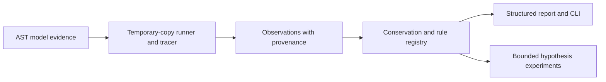

# EpsilonMu

**Status: early experimental development.** EpsilonMu is not suitable for validating production scientific results. Passing available checks does not establish that a simulation is physically correct.

**An agentic debugger for computational physics.**

Scientific code can execute successfully while still producing physically incorrect results. EpsilonMu combines deterministic physics verification with a limited agentic investigation of those failures. Version 0.1 implements deterministic checks and one bounded timestep hypothesis experiment. Automatic patching and repair verification remain planned work.

## Install

Use Python 3.10 or newer:

```bash
python -m pip install -e .
python -m pip install -e '.[test]'
pytest
```

EpsilonMu itself has no runtime dependencies. Target simulations may require NumPy, SciPy, SymPy, Pint, or Matplotlib in the same Python environment.

## 30-second example

```bash
epsilonmu inspect examples/oscillator/unstable.py
epsilonmu verify examples/oscillator/unstable.py
epsilonmu verify examples/oscillator/correct.py
```

Expected summary:

```text
EpsilonMu | unstable.py | oscillator
  PASS    finite states: All supplied state samples are finite
  FAIL    energy: Maximum relative drift ...
Status: FAIL
```

An ordinary standalone Python script can be inspected without adding an EpsilonMu API. EpsilonMu runs a temporary copy once and traces bounded numeric scalars and arrays, including function locals. It also reads simple labeled numbers from stdout. Observations record whether they came from static source, stdout, instrumentation, or explicit output. A script may still print `EPSILONMU_JSON:` followed by a JSON object to declare specific evidence. Supported explicit fields are `states`, `kinetic` and `potential`, `linear_momentum`, `angular_momentum`, paired `timesteps` and `observables`, `constraints`, and an optional `units` map. A successful run with no checkable evidence yields `UNKNOWN`.

Checks are conditional on model assumptions: energy conservation applies to a closed conservative system, and momentum conservation requires a closed system. Automatically recovered energy drift is a warning when EpsilonMu cannot establish a conservative mechanics model. `inspect` exposes classification confidence and the structural evidence used. Passing available checks is not proof that the physical model is correct.

## Commands

```text
epsilonmu inspect SCRIPT
epsilonmu test SCRIPT [--timeout SECONDS]
epsilonmu verify SCRIPT [--timeout SECONDS]
epsilonmu debug SCRIPT [--timeout SECONDS] [--max-experiments N]
```

`test` and `verify` currently share a deterministic pipeline. `debug` additionally tests a timestep hypothesis when it finds energy drift, a literal `dt`, and one `range(N)` loop. It halves `dt` on temporary copies and scales the loop count to preserve simulated duration, up to two experiments by default. A decrease in drift supports a numerical-error explanation; it does not validate the force law. Exit code is 1 on `FAIL`, 0 on `PASS`, `WARNING`, or `UNKNOWN`, and 2 for invalid command input. Always read the status rather than inferring a pass from exit code 0.

## Architecture



The runner copies one script to a temporary working directory and applies a timeout, but **does not isolate code from the host**. Only run scripts you trust. Local sibling imports, input files, subprocesses, native extensions, and code that depends on its original path may need adaptation or may escape the intended bounds. No command edits the target file.

## Supported physics and roadmap

The deterministic classifier recognizes selected restoring, two-axis gravity, and inverse-square central-force update patterns. It returns `UNKNOWN` when evidence is insufficient. The validation registry covers redundant `F = ma`, `g = GM/r²`, momentum, kinetic-energy, and spring-force relationships, declared SI dimensions, a declared SI gravitational constant, and cautious parameter plausibility. An explicit `"environment": "earth_surface"` in EpsilonMu JSON enables a **reference warning** for local gravity; an unusual value alone cannot establish a bug. Only simple scalar relationships and one-dimensional numeric series are supported. The experiment loop tests one timestep hypothesis; source repair and an external LLM provider remain future work. Additional domains can implement the `PhysicsSkill` protocol.

## Contributing

Run `pytest` and include a correct/broken example pair for new checks. State the physical assumptions, an injected defect the check catches, and a counterexample it cannot catch. Avoid claiming that a heuristic proves correctness.
