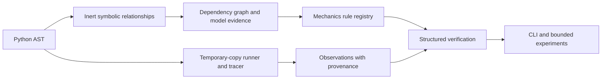

# EpsilonMu

Independent validation of experimental v0.3 commit `0c938d0` reproduced four previously evaluated cases. All 60 public tests passed. The verifier recognized projectile and oscillator dynamics and flagged an Earth-gravity discrepancy. It missed a gravitational radial-law discrepancy and detected oscillator energy growth without diagnosing Euler instability. Private timestep refinement correctly declined unequal durations. A public equal-duration control reduced drift. Accuracy on unseen simulations remains unknown.

**Status: early experimental development.** EpsilonMu is not suitable for validating production scientific results. Passing available checks does not establish that a simulation is physically correct.

**An agentic debugger for computational physics.**

Scientific code can execute successfully while still producing physically incorrect results. EpsilonMu combines deterministic physics verification with bounded, evidence-driven debugging. Version 0.3 extracts symbolic relationships and dependency chains from Python AST without evaluating source expressions. Automatic patching and LLM reasoning are not implemented.

## Install

Use Python 3.10 or newer:

```bash
python -m pip install -e .
python -m pip install -e '.[test]'
pytest
```

EpsilonMu itself has no runtime dependencies. Target simulations may require NumPy, SciPy, SymPy, Pint, or Matplotlib in the same Python environment.

## 30-second example

```bash
epsilonmu inspect examples/oscillator/unstable.py
epsilonmu verify examples/oscillator/unstable.py
epsilonmu verify examples/oscillator/correct.py
```

Expected summary:

```text
EpsilonMu | unstable.py | harmonic oscillator
Numerical checks:
  PASS    finite states: All supplied state samples are finite
  FAIL    energy: Maximum relative drift ...
Overall: FAILED
```

An ordinary standalone Python script can be inspected without adding an EpsilonMu API. EpsilonMu runs a temporary copy once and traces bounded numeric scalars and arrays, including function locals. It also reads simple labeled numbers from stdout. Observations record whether they came from static source, stdout, instrumentation, or explicit output. A script may still print `EPSILONMU_JSON:` followed by a JSON object to declare specific evidence. Supported explicit fields are `states`, `kinetic` and `potential`, `linear_momentum`, `angular_momentum`, paired `timesteps` and `observables`, `constraints`, and an optional `units` map. A successful run with no checkable evidence yields `UNKNOWN`.

Checks are conditional on model assumptions: energy conservation applies to a closed conservative system, and momentum conservation requires a closed system. Automatically recovered energy drift is a warning when EpsilonMu cannot establish a conservative mechanics model. `inspect` exposes classification confidence, structural evidence, relationships, source lines, and dependency edges. Passing available checks is not proof that the physical model is correct.

## Commands

```text
epsilonmu inspect SCRIPT
epsilonmu test SCRIPT [--timeout SECONDS]
epsilonmu verify SCRIPT [--timeout SECONDS]
epsilonmu debug SCRIPT [--timeout SECONDS] [--max-experiments N]
```

`test` and `verify` currently share a deterministic pipeline. Overall outcomes are `VERIFIED`, `FAILED`, and `INCONCLUSIVE`; individual checks use `PASS`, `FAIL`, `WARNING`, or `UNKNOWN`. `VERIFIED` requires an identified model and at least one supported physical check, and still covers only the checks EpsilonMu ran. Finiteness alone is `INCONCLUSIVE`. `debug` reports symbolic relationship failures as hypotheses and tests a timestep hypothesis when it finds energy drift, a literal `dt`, and one `range(N)` loop. It halves `dt` on temporary copies and scales the loop count to preserve simulated duration, up to two experiments by default. A decrease in drift supports a numerical-error explanation; it does not validate the force law. Exit code is 1 on `FAILED`, 0 on other outcomes, and 2 for invalid command input.

## Architecture



The runner copies one script to a temporary working directory and applies a timeout, but **does not isolate code from the host**. Only run scripts you trust. Local sibling imports, input files, subprocesses, native extensions, and code that depends on its original path may need adaptation or may escape the intended bounds. No command edits the target file.

## Supported physics and roadmap

The deterministic classifier recognizes selected restoring, two-axis constant-acceleration, and Newtonian central-force structures. Context from docstrings, comments, function names, and metadata is treated as fallible evidence. The mechanics registry represents `F = ma`, `p = mv`, `K = ½mv²`, uniform-field `U = mgh`, spring `F = -kx` and `U = ½kx²`, gravitational `F = Gm₁m₂/r²` and vector acceleration, `E = K + U`, and constant-acceleration position and velocity formulas. The symbolic subset normalizes reordered products, powers, division, `pow`, `sqrt`, and `hypot`; unsupported Python expressions remain unverified. The dimensional foundation covers mass, length, time, electric current, and temperature, with derived mechanics dimensions. The runtime plausibility registry still supports declared SI units and cautious parameter checks. Earth-surface text plus an SI hint or explicit `"environment": "earth_surface"` and units enables a **reference warning** for local gravity; an unusual value alone cannot establish a bug. Only mechanics is implemented. The experiment loop tests one timestep hypothesis; source repair and an external LLM provider remain future work.

## Contributing

Inspection binds candidate roles from shared integration steps in scalar component updates and from explicit SI string annotations such as `load: "kg"`. Multiple candidates can share a dimension. Strong gravitational intent enables a component-level radial exponent check. A matching radial power alone does not establish the coefficient or the physical origin of a force.

Timestep experiments also accept a single top-level loop of the form `while clock < end` with one unconditional `clock += step`. The start, step and end must resolve to fixed numeric literals. The experiment checks the actual floating-point step counts before comparing drift. Refined runs that would change duration, nested integration loops, and early exits are unsupported. Explicit synchronized energy series provide the strongest drift evidence.

Symbolic comparisons use SymPy on expressions constructed from the AST. For example, distributing a scalar across a sum of indexed components preserves equivalence. Fixed integer component reads, NumPy square and square root, and selected unary functions are supported. Role binding still relies on aliases for several laws. Results for arbitrary variable names, conditional assignments and general array broadcasting are incomplete.

Run `pytest` and include a correct/broken example pair for new checks. State the physical assumptions, an injected defect the check catches, and a counterexample it cannot catch. Avoid claiming that a heuristic proves correctness.
