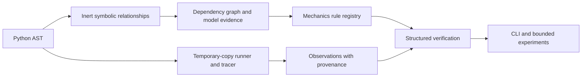

# EpsilonMu

**Experimental development checkpoint · `0.5.1.dev0`.** Independent revalidation ran all 111 public tests successfully and repeated seven established synthetic controls twice. The verifier detected the reversed restoring direction after the spring variables were renamed. The other six verdicts stayed unchanged. A separate loopback HTTP test confirmed that each retry required approval for its destination and payload and that denying a retry prevented a second transmission.

The controls used a mock planner. Only the timestep-refinement case generated new experimental evidence. The spring check established the direction of linear acceleration, leaving its magnitude unverified. Performance on unseen models, live-model reasoning, and native credential storage remain unverified. Simulation code still runs with the researcher's host permissions.

Independent validation of experimental v0.3 commit `0c938d0` reproduced four previously evaluated cases. All 60 public tests passed. The verifier recognized projectile and oscillator dynamics and flagged an Earth-gravity discrepancy. It missed a gravitational radial-law discrepancy and detected oscillator energy growth without diagnosing Euler instability. Private timestep refinement correctly declined unequal durations. A public equal-duration control reduced drift. Accuracy on unseen simulations remains unknown.

**Status: early experimental development.** EpsilonMu is not suitable for validating production scientific results. Passing available checks does not establish that a simulation is physically correct.

**An agentic debugger for computational physics.**

Scientific code can execute successfully while still producing physically incorrect results. EpsilonMu extracts symbolic relationships from Python AST and runs bounded numerical experiments. The v0.4 development branch adds an optional provider client. The inspect, verify and debug commands continue to operate locally and produce deterministic findings.

## Optional AI configuration

### Experimental v0.5 investigation

In 0.5.1 each transmission, including a rate-limit retry, presents the destination and payload again. Declining ends the request before another attempt is charged or sent. Authorization records contain only the retry index and approval decision. Reports label baseline observations, baseline checks, contextual references, model hypotheses and new experiments. A prediction of WARNING can agree with a contextual reference without confirming a parameter error. UNKNOWN is compared as INCONCLUSIVE while the original check status remains visible.

The harmonic-oscillator sign check follows paired position and velocity updates and resolves scalar assignments at the point where velocity changes. For a demonstrably linear acceleration about zero displacement, it checks whether the coefficient is negative. This checks direction only. Unknown coefficient signs, nonlinear or offset laws and unsupported control flow can leave the relationship unverified. Coverage lists registry relationships separately from model recognition.

`epsilonmu debug examples/orbit/bad_timestep.py --agent --max-steps 4 --max-attempts 4 --max-tokens 16000 --deadline 60` enables model-assisted investigation of a trusted simulation. Configure a provider and explicitly enable all three evidence categories first. Each provider request shows a payload preview. Baseline execution and each proposed tool require researcher approval. The default debug command still works offline.

The agent proposes bounded, testable predictions about a named deterministic check or whether one equal-duration timestep refinement will reduce energy drift. Other actions retrieve static relationships, model recognition, numerical observations or existing evidence. Its JSON report records the source hash, baseline outcome, measured values and provenance, check IDs, model predictions, supporting or contradicting tool records, experiment conditions, budget use and stopping reason. Only deterministic results assess predictions. Agreement with an existing baseline check supplies no independent experimental confirmation. A decrease in drift supports sensitivity to the timestep under the tested conditions.

Use `--timeout` for simulation execution, and optionally `--max-cost` with `--rates INPUT OUTPUT` for a local cost estimate. The investigation uses one shared in-memory provider budget. Deadlines are cooperative. Inspect untrusted output as data and run only trusted simulations: the original script executes on your machine. A declined request, unsupported model, repeated action, invalid proposal, provider failure or exhausted budget can leave the investigation incomplete. The recorded baseline verdict retains its original scope. Live inference and native keyring integration remain unverified.

Run `epsilonmu providers list`, then `epsilonmu configure`. Choose the provider, a model available to your account or local server, the API base URL, an authentication method, and the allowed evidence categories. Configuration defaults to loopback-only access and an empty sharing policy. Use `127.0.0.1` or `[::1]` for local servers. Cloud connections require HTTPS and explicit remote configuration.

| Provider | Authentication | API |
|---|---|---|
| OpenAI | OPENAI_API_KEY or native keyring | [Chat completions](https://platform.openai.com/docs/api-reference/chat/create) |
| Anthropic | ANTHROPIC_API_KEY or native keyring | [Messages](https://platform.claude.com/docs/en/api/messages/create) |
| Gemini | GEMINI_API_KEY or native keyring | [Generate content](https://ai.google.dev/api/generate-content) |
| Ollama | Local server, no key | [Chat](https://docs.ollama.com/api/chat) |
| OpenAI-compatible | EPSILONMU_API_KEY, native keyring, or none | Chat completions with JSON response format |

Install `pip install -e ".[credentials]"` to enable supported native OS credential stores. With environment authentication, set the variable outside the configuration file. The saved path is printed by configure. Use `epsilonmu config show` to inspect nonsecret settings and `epsilonmu config reset` to remove the active configuration and its active keyring entry. Reset before switching keyring accounts if you want the old credential removed. Model names and endpoint paths are public configuration identifiers. Never embed secrets there.

`epsilonmu providers test` previews a fixed connectivity prompt and asks for confirmation before sending it. Cloud probes can incur usage charges. To interpret selected research evidence programmatically:

```python
from epsilonmu.ai.client import Client, Evidence
from epsilonmu.ai.configuration import load

def approve(preview):
    print(preview)
    return input("Send this payload? [y/N] ").lower() == "y"

client = Client(load())
evidence = Evidence(measurements=("Observed drift: 2.1%",),
                    hypotheses=("Timestep sensitivity suspected",))
advisory = client.interpret(evidence, approve)
print(advisory.commentary)
```

Enable each required category during configuration. Supply deterministic conclusions separately in `Evidence.conclusions`. The response schema accepts only commentary, with token counts taken from the provider envelope. Keep the original verification report alongside any interpretation. Commentary can be inaccurate. Previews exclude authentication headers and redact configured keys and common credential assignments. Review the entire payload for confidential content. A custom or local endpoint must be trusted, since the receiving server controls its own logging and onward routing. For offline Ollama use local weights and disable cloud features on the server.

Edit the nonsecret numeric fields in the config file to set `max_input`, `max_output`, `context`, `requests`, `timeout` (seconds), and `retries`. Input admission uses UTF-8 byte length plus a framing allowance as a conservative estimate. Output limits are sent to the server. Each client enforces its configured attempt limit, including retries. Clients can also share an investigation budget. Only short HTTP 429 retries are automatic. Usage totals sum valid directional counts from accepted, rejected, and readable HTTP error responses. The unknown_usage counter counts attempts with either direction missing. A subtotal of zero with unknown usage does not establish zero billing. With reliable model-specific prices per million tokens, call `advisory.estimated_cost(input_rate, output_rate)`. This is a simple estimate excluding discounts and special billing categories. It cannot enforce an exact spending limit.

## Investigation limits and subprocess environment

The integration audit found that simulation children inherited provider keys and that malformed commentary could discard usage data. The runner now constructs a fresh environment for every baseline, trace and refinement child. It uses the current Python executable by absolute path, sets the headless Matplotlib backend, and copies only system-root, temporary-directory and locale settings (`SYSTEMROOT`, `WINDIR`, `TEMP`, `TMP`, `TMPDIR`, `LANG`, `LC_ALL`, `LC_CTYPE`). Use the explicit Python argument `verify_file(script, forward_env=("LAB_DATA_DIR",))` or the same argument to `investigate_timestep` for a trusted simulation that needs extra variables. Forwarded variables are visible to the entire child process. Choose only nonsecret settings. This environment restriction is not a security sandbox. Scripts still run with the user's filesystem and other host permissions.

```python
from epsilonmu.ai.budget import Budget
from epsilonmu.ai.client import Client

# Example prices only. Supply verified prices in one currency per million tokens.
budget = Budget(max_attempts=6, max_tokens=8000, max_cost="0.05",
                rates=("1", "3"), deadline_seconds=30)
first = Client(config, budget=budget)
second = Client(config, budget=budget)
```

Share the same in-memory object across clients in one investigation. It reserves estimated input and maximum output before each transmission. Once the attempt ends, measured counts replace reservations independently for each direction. Unknown directions retain their estimates against the limit. The ledger distinguishes successful interpretations, rejected responses, failed attempts, and attempts with incomplete usage. Retries consume fresh reservations. A request that fails before dispatch approval consumes none. Requests already in flight, unreported server work, model-specific billing rates, and inaccurate token estimates can cause actual bills to exceed estimates. For mixed models, use conservative shared rates. The monotonic deadline limits admission, retry waits and per-attempt timeouts, and rejects late results. It cannot cancel provider-side execution or forcibly interrupt a stalled custom transport. No billing reconciliation or cross-process limit is provided.

Live inference compatibility and native OS credential storage remain unverified. Tests use synthetic credentials, mocked providers and a loopback HTTP fixture.

## Install

Use Python 3.10 or newer:

```bash
python -m pip install -e .
python -m pip install -e '.[test]'
pytest
```

EpsilonMu itself has no runtime dependencies. Target simulations may require NumPy, SciPy, SymPy, Pint, or Matplotlib in the same Python environment.

## 30-second example

```bash
epsilonmu inspect examples/oscillator/unstable.py
epsilonmu verify examples/oscillator/unstable.py
epsilonmu verify examples/oscillator/correct.py
```

Expected summary:

```text
EpsilonMu | unstable.py | harmonic oscillator
Numerical checks:
  PASS    finite states: All supplied state samples are finite
  FAIL    energy: Maximum relative drift ...
Overall: FAILED
```

An ordinary standalone Python script can be inspected without adding an EpsilonMu API. EpsilonMu runs a temporary copy once and traces bounded numeric scalars and arrays, including function locals. It also reads simple labeled numbers from stdout. Observations record whether they came from static source, stdout, instrumentation, or explicit output. A script may still print `EPSILONMU_JSON:` followed by a JSON object to declare specific evidence. Supported explicit fields are `states`, `kinetic` and `potential`, `linear_momentum`, `angular_momentum`, paired `timesteps` and `observables`, `constraints`, and an optional `units` map. A successful run with no checkable evidence yields `UNKNOWN`.

Checks are conditional on model assumptions: energy conservation applies to a closed conservative system, and momentum conservation requires a closed system. Automatically recovered energy drift is a warning when EpsilonMu cannot establish a conservative mechanics model. `inspect` exposes classification confidence, structural evidence, relationships, source lines, and dependency edges. Passing available checks is not proof that the physical model is correct.

## Commands

```text
epsilonmu inspect SCRIPT
epsilonmu test SCRIPT [--timeout SECONDS]
epsilonmu verify SCRIPT [--timeout SECONDS]
epsilonmu debug SCRIPT [--timeout SECONDS] [--max-experiments N]
```

`test` and `verify` currently share a deterministic pipeline. Overall outcomes are `VERIFIED`, `FAILED`, and `INCONCLUSIVE`; individual checks use `PASS`, `FAIL`, `WARNING`, or `UNKNOWN`. `VERIFIED` requires an identified model and at least one supported physical check, and still covers only the checks EpsilonMu ran. Finiteness alone is `INCONCLUSIVE`. `debug` reports symbolic relationship failures as hypotheses and tests a timestep hypothesis when it finds energy drift, a literal `dt`, and one `range(N)` loop. It halves `dt` on temporary copies and scales the loop count to preserve simulated duration, up to two experiments by default. A decrease in drift supports a numerical-error explanation; it does not validate the force law. Exit code is 1 on `FAILED`, 0 on other outcomes, and 2 for invalid command input.

## Architecture



The runner copies one script to a temporary working directory and applies a timeout, but **does not isolate code from the host**. Only run scripts you trust. Local sibling imports, input files, subprocesses, native extensions, and code that depends on its original path may need adaptation or may escape the intended bounds. No command edits the target file.

## Supported physics and roadmap

The deterministic classifier recognizes selected restoring, two-axis constant-acceleration, and Newtonian central-force structures. Context from docstrings, comments, function names, and metadata is treated as fallible evidence. The mechanics registry represents `F = ma`, `p = mv`, `K = ½mv²`, uniform-field `U = mgh`, spring `F = -kx` and `U = ½kx²`, gravitational `F = Gm₁m₂/r²` and vector acceleration, `E = K + U`, and constant-acceleration position and velocity formulas. The symbolic subset normalizes reordered products, powers, division, `pow`, `sqrt`, and `hypot`; unsupported Python expressions remain unverified. The dimensional foundation covers mass, length, time, electric current, and temperature, with derived mechanics dimensions. The runtime plausibility registry still supports declared SI units and cautious parameter checks. Earth-surface text plus an SI hint or explicit `"environment": "earth_surface"` and units enables a **reference warning** for local gravity; an unusual value alone cannot establish a bug. Only mechanics is implemented. The experiment loop tests timestep sensitivity. Provider commentary is optional and separate from the experiment results.

## Contributing

Inspection binds candidate roles from shared integration steps in scalar component updates and from explicit SI string annotations such as `load: "kg"`. Multiple candidates can share a dimension. Strong gravitational intent enables a component-level radial exponent check. A matching radial power alone does not establish the coefficient or the physical origin of a force.

Timestep experiments also accept a single top-level loop of the form `while clock < end` with one unconditional `clock += step`. The start, step and end must resolve to fixed numeric literals. The experiment checks the actual floating-point step counts before comparing drift. Refined runs that would change duration, nested integration loops, and early exits are unsupported. Explicit synchronized energy series provide the strongest drift evidence.

Symbolic comparisons use SymPy on expressions constructed from the AST. For example, distributing a scalar across a sum of indexed components preserves equivalence. Fixed integer component reads, NumPy square and square root, and selected unary functions are supported. Role binding still relies on aliases for several laws. Results for arbitrary variable names, conditional assignments and general array broadcasting are incomplete.

Run `pytest` and include a correct/broken example pair for new checks. State the physical assumptions, an injected defect the check catches, and a counterexample it cannot catch. Avoid claiming that a heuristic proves correctness.
